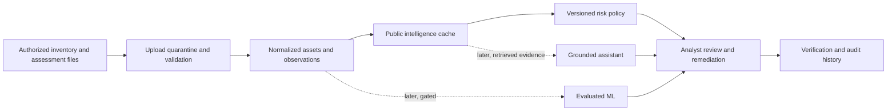

# VulnGuard AI — Master Project Plan (Version 3)

**Full name:** Intelligent Vulnerability Management, Risk Prioritization & Remediation Platform  
**Project owner:** Olufunmiwa Emmanuel Oluwatosin  
**Date:** 4 November 2026  
**Status:** Planned; development and ML training have not started  
**Purpose:** Build a credible portfolio project with a safe, incremental path toward operational use.

> **Product principle:** Make imported findings reliable, explainable, and actionable before adding predictive features. The system reports evidence and policy decisions separately, and never treats an ML or generated answer as a verified security fact.

## 1. Executive summary

VulnGuard helps an authorized organization maintain an asset inventory, import vulnerability assessment results, enrich reported CVEs with public intelligence, prioritize remediation using a versioned policy, track work, and produce evidence-based reports. A later release may add evaluated ML and source-grounded language assistance.

**Primary users:** Security analysts and IT/remediation owners.  
**Secondary users:** Security managers. Managed providers and multiple customer organizations are later-stage capabilities, not MVP requirements.

**MVP boundaries:** Import existing authorized assessment data; no active scanning, exploit execution, automatic patching, or claims that a CVE applies to software unless the input contains enough evidence to support that claim. Use fictional data in public demos. Treat the first deployment as a single organization until tenant isolation is designed and tested.

## 2. Product outcomes and measures

The first release succeeds when an analyst can answer: **What was reported? Which asset did it come from? What evidence supports its priority? Who owns the next action? Was closure verified?**

Track product measures that can be computed from recorded events:

- Import acceptance rate and row-level rejection reasons.
- Percentage of findings linked to a known asset and a CVE record.
- Time from import to assignment, and assignment to verified resolution.
- Findings with complete evidence, owner, and next-action date.
- Analyst agreement with the displayed risk ordering from a small, documented review set.

Do not present these as security-risk reduction or breach-prevention measures without a defensible study. Establish a baseline before claiming improvement.

## 3. Users and workflows

### Analyst

1. Creates or imports assets and maps scanner identifiers to stable VulnGuard asset IDs.
2. Uploads a supported assessment file, previews validation results, then confirms import.
3. Reviews findings, source freshness, matching confidence, policy score, and missing evidence.
4. Assigns a remediation owner and due date, then tracks status and verification evidence.
5. Exports a filtered report with a generation timestamp and source references.

### Remediation owner

1. Sees assigned tasks and affected assets.
2. Records progress and remediation notes.
3. Requests verification; an authorized analyst records the verification result and evidence.

### Manager

Reviews aggregate trends and overdue work without needing access to secrets or raw upload contents beyond their authorization.

## 4. Interface and navigation

Use a professional, responsive operations dashboard: dark navy navigation, neutral content surfaces, teal actions, and accessible severity colors. Color must not be the only status cue; include text and icons, keyboard navigation, visible focus, and sufficient contrast.

| Screen | Core content |
| --- | --- |
| Overview | Open and overdue work, severity and priority distributions, recent activity, freshness indicators |
| Assets | Inventory, owner, environment, exposure, business importance and data provenance |
| Findings | Search, filters, stable finding identity, status, CVSS, KEV evidence and organizational priority |
| Finding detail | Original report evidence, CVE match basis, source records, score calculation, history and actions |
| Remediation | Assignment, due date, workflow, verification result and evidence |
| Intelligence | Source status, retrieval/update time, stale or unavailable feeds |
| Reports | Time-bounded summaries, filters, methodology and export timestamp |
| Administration | User access, policy versions, import settings and audit events |
| ML Insights (later) | Only enabled models, intended use, uncertainty, evaluation, version and fallback state |

Any example dashboard counts must be marked as fictional demo data. Avoid a populated dashboard that could be mistaken for measured organizational results.

## 5. Architecture and design choices

Begin with a **modular monolith**: React/TypeScript frontend, FastAPI API, PostgreSQL database, and a separately runnable background worker only when external feed updates or imports need asynchronous processing. Use Docker Compose for reproducible local setup if it reduces environment friction. Do not add microservices, a message broker, Kubernetes, or a model-serving platform before a demonstrated need.



### Stack

| Area | Initial choice | Decision rule |
| --- | --- | --- |
| API | Python, FastAPI, Pydantic | Keep request and response schemas explicit |
| Persistence | PostgreSQL, SQLAlchemy, Alembic | Use migrations; avoid production reliance on ad hoc schema creation |
| UI | React, TypeScript, Tailwind CSS | Favor accessible, typed components |
| Charts | Recharts or simple tables | Add charts only where they improve decisions |
| Intelligence | NVD, CISA KEV, official vendor advisories | Cache source payload metadata and retrieval time; handle limits and outages |
| ML | pandas, NumPy, scikit-learn; optional gradient boosting later | A model is optional and gated by data/evaluation |
| Tests and CI | pytest, frontend unit tests, Playwright for critical flows, GitHub Actions | Automate the agreed acceptance checks |
| Runtime | Local development first; Docker Compose when useful | No GPU required for MVP |

Pin dependency versions and document supported Python, Node, and database versions once repository setup begins. Keep secrets out of source control.

## 6. Release 1 — trustworthy single-organization MVP

### Included

1. **Asset inventory:** stable internal ID, external scanner ID(s), name, environment, owner/team, business importance, exposure classification, and source/update timestamps. Keep sensitive network details optional.
2. **Assessment imports:** start with one documented CSV format and one JSON format only if a real use case needs both. Preview before commit. Validate size, encoding, columns, types, and row count. Report row-level errors. Store file hash, uploader, import time, parser version, and source label; apply retention limits to raw files.
3. **Observation and finding lifecycle:** retain scanner observations separately from the current deduplicated finding view. Define deterministic identity and re-open/close behavior for findings across repeated imports. Preserve first seen, last seen, and the source import.
4. **CVE enrichment:** accept CVE IDs supplied by the report; fetch/cache NVD and KEV information with rate-limit, timeout, retry, stale-cache, and unavailable-source behavior. A CVE match is not proof of affected product/version. Preserve source URLs, retrieval time, and the original scanner assertion.
5. **Risk policy:** versioned deterministic score with a visible breakdown, missing-data state, and documented thresholds. CVSS, KEV listing, and organization-specific priority remain separate fields. Never silently convert unknown exposure or missing data to safe.
6. **Remediation:** Open → Assigned → In Progress → Pending Verification → Resolved, with an explicit reopen path. Record actor, timestamp, prior/new state, and verification outcome. Restrict who can mark work verified.
7. **Access control:** single-organization accounts with administrator, analyst, remediation owner, and read-only manager roles. Enforce authorization at every object and action boundary. Use secure password hashing, session/token expiry and rotation, and rate limits for authentication-sensitive routes.
8. **Reporting:** unresolved priority findings, owners, due dates, import coverage, and remediation trends. Every export states filters and generation time; escape spreadsheet formula prefixes in CSV exports.

### Explicitly deferred

Multi-tenant SaaS, SSO, external integrations, API key management, active discovery/scanning, automatic remediation, custom report builder, ML predictions, and generated AI explanations. This keeps the MVP small enough to finish and permits later design decisions to use actual feedback.

### Demonstration risk policy

An illustrative policy could be:

`priority = min(100, 5 × CVSS_base + KEV_bonus + exposure_bonus + business_impact_bonus)`

This formula is only a starting example, not an industry standard. Define bounds, missing-value behavior, thresholds, and policy version. Save the exact inputs and contributions used in each assessment so results can be reproduced. Keep CVSS severity distinct from local priority and explain that a score is a decision aid, not a probability of compromise.

## 7. MVP acceptance gates

The MVP is ready for a portfolio demo when all of the following are demonstrated with synthetic data:

- A user can preview an import, understand rejected rows, confirm valid rows, and trace each finding to its import and source evidence.
- Reimporting the same assessment does not create unintended duplicate tasks or erase historical observations; changed and missing observations follow documented rules.
- Source lookup failure or stale data is visible and does not block safe review of the original report.
- Identical inputs plus the same policy version produce the same score and explanation.
- Every workflow transition records actor and time; unauthorized verification and access attempts are rejected.
- Critical user journeys work with keyboard navigation and clear loading, empty, error, and stale-source states.
- Public demo data is fictional, and logs/API errors do not disclose credentials, raw secrets, or unnecessary uploaded content.
- Setup from a clean checkout is documented and repeatable; database migrations work forward and backup/restore steps are documented for the demo deployment.

## 8. Security, privacy, and operational requirements

Threat model the import, authentication, authorization, source enrichment, exports, and deployment before external hosting. The main MVP risks include malicious or malformed uploads, cross-user object access, credential leakage, unsafe CSV exports, excessive data retention, dependency vulnerabilities, and logs containing sensitive data.

- Treat uploads and scanner descriptions as untrusted input. Apply limits, safe parsing, content validation, and non-executable storage. Do not render imported HTML.
- Use parameterized database access, output encoding, CSRF protections where cookie sessions are used, secure cookies, TLS in hosted environments, and security headers.
- Keep secrets in environment/configuration management, never in the repository or demo data. Redact tokens and sensitive fields from logs.
- Define backup, restore, retention, deletion, and incident-response procedures before storing real operational data.
- Keep network egress to configured intelligence sources; set timeouts and avoid allowing user-controlled URLs to trigger server-side requests.
- Pin and update dependencies; review container images and least-privilege runtime configuration before deployment.
- Use only data the operator is authorized to process. Do not upload real customer findings to a public portfolio demo.

## 9. Data model and provenance

Suggested core records:

- `users`, `organizations` (single organization in MVP), `memberships` or role assignments.
- `assets`, `asset_identifiers`, optional `software_inventory` with source and observed time.
- `imports`, `import_rows` or row-level import results, and `observations` for immutable scanner evidence.
- `vulnerabilities`, `intelligence_snapshots` with source, source timestamp, retrieval timestamp, and payload/version metadata.
- `findings` as the current lifecycle view, linked to one or more observations and asset identifiers.
- `risk_policy_versions`, `risk_assessments` including inputs and factor contributions.
- `remediation_tasks`, `task_events`, `verification_records`, `audit_events`.
- Later only: `model_versions`, `prediction_records`, training/evaluation dataset references.

Store UTC timestamps; render local times in the UI. Use foreign keys and indexes for organization/asset/finding filters. Avoid storing full external source payloads indefinitely if metadata plus a cache can meet the need; define refresh and retention behavior.

## 10. API outline

Use consistent pagination, filtering, validation, error shapes, API versioning, and authorization. Keep upload and workflow operations auditable.

| Endpoint | Function |
| --- | --- |
| `POST /api/v1/imports/preview` | Validate file and return row outcomes without committing |
| `POST /api/v1/imports` | Confirm and create an import |
| `GET /api/v1/imports/{id}` | Inspect import status, counts, and errors |
| `GET /api/v1/assets` | List accessible assets |
| `GET /api/v1/findings` | Filter/page findings |
| `GET /api/v1/findings/{id}` | Evidence, matching basis, intelligence, risk, and history |
| `POST /api/v1/findings/{id}/assessments` | Create a policy-versioned assessment |
| `GET /api/v1/intelligence/cves/{cve_id}` | Retrieve cached source records and freshness |
| `POST /api/v1/remediations` | Assign remediation |
| `PATCH /api/v1/remediations/{id}` | Update allowed workflow fields |
| `POST /api/v1/remediations/{id}/verification` | Record authorized verification result |
| `GET /api/v1/dashboard/summary` | Return filtered aggregates |

Avoid exposing the future ML route until there is a model that passes its release gate.

## 11. Delivery plan and decision gates

| Phase | Deliverable | Exit evidence |
| --- | --- | --- |
| 0. Scope and setup | Repository, README, local environment, threat sketch | Clean setup and agreed first import format |
| 1. Data foundation | Schema, migrations, synthetic seed data | Assets and observations persist and migrate |
| 2. Import vertical slice | Preview, row errors, provenance, deduplication | Reimport behavior is documented and demonstrated |
| 3. Intelligence | NVD/KEV cache, freshness, outage handling | Known fixture cases and visible stale/unavailable states |
| 4. Risk and workflow | Versioned scoring, explanation, assignment and verification | Reproducible scores and complete event history |
| 5. Usable UI | Overview, assets, findings, detail, remediation, reports | Analyst workflow completed end to end |
| 6. Security and release | Access checks, upload controls, audit review, CI, demo packaging | Acceptance gates in Section 7 pass |
| 7. ML data decision | Data inventory and label/quality analysis | Written go/no-go; no model required to complete MVP |
| 8. Optional ML | One model, baseline, evaluation, model card | Release gate below passes |
| 9. Optional grounded assistant | Retrieval, citations, injection controls | Source review and analyst approval workflow demonstrated |

Plan by working milestones rather than a fixed calendar promise. A polished single-organization MVP is a more useful outcome than starting several incomplete advanced features.

## 12. ML and AI release gates

### Remediation-time estimate (candidate first model)

Only proceed when there is sufficient, permissioned, representative historical data with reliable timestamps and explicit treatment of still-open cases. Compare with a simple median/quantile baseline. Use chronological holdouts, leakage checks, error analysis across teams and asset classes, and calibrated intervals or probabilities where applicable. Show intended use, limitations, model version, data period, and fallback. If data is inadequate, keep the feature unavailable or show a clearly labeled synthetic demonstration that cannot be confused with a trained production model.

### Other candidate ML

- Risk ranking: evaluate against analyst-reviewed labels and a deterministic policy; report precision at reviewed capacity, missed urgent findings, and subgroup differences.
- Anomaly detection: anomalies mean unusual observations, not compromise. Measure alert volume and false-alert burden.
- Deduplication: retain deterministic identity as the default; embeddings may suggest matches for human review and must be evaluated on reviewed pairs.

For every model, document intended use, prohibited interpretations, data provenance, baseline, evaluation split, performance, limitations, owner, version, and disable/fallback procedure. Never use a prediction as proof that a vulnerability is exploitable or a system is compromised.

### Grounded assistant

Retrieve from official advisories and the product's own verified records. Present source links and retrieval dates beside claims. Treat retrieved text and imported descriptions as untrusted; constrain tools and prompts, and prevent instructions inside data from changing assistant behavior. The assistant may summarize or draft, but an analyst approves actions and claims before use.

## 13. Expansion path

After the MVP is used and its access model is understood, consider tenant separation, SSO, integrations, queues, API tokens, stronger monitoring, and deployment hardening. Multi-tenancy requires organization scoping in every query, authorization test coverage, tenant-aware uniqueness constraints, and a threat review; adding an `organization_id` column alone is not sufficient. Active discovery or scanning, if ever added, requires explicit authorization, scope controls, rate limits, and safe operational procedures.

## 14. Portfolio demonstration

Use a fictional organization and clearly labeled synthetic assets and findings. Demonstrate import preview, a repeated import, a stale/unavailable intelligence source, a risk explanation, task assignment, verification, and an export. Show the app's limitations and the no-model state honestly. Portfolio materials: architecture, setup guide, sample files, API documentation, screenshots/video, test approach, threat assumptions, and (if applicable) model card.

## 15. Suggested repository layout

```text
vulnguard-ai/
  README.md
  docs/
    architecture.md
    security-and-privacy.md
    import-format.md
    risk-policy.md
  backend/
    app/
      api/ auth/ assets/ imports/ intelligence/ risk/ remediation/ reports/
    migrations/
    tests/
  frontend/
  demo_data/
  infra/
  docker-compose.yml
```

Add `ml/` only when the data and evaluation gate is met. Keep real datasets out of the repository and document synthetic data generation separately.

## 16. Immediate next step

Confirm the first supported scanner CSV schema and create a small synthetic fixture that includes valid rows, missing fields, duplicate observations, and malformed rows. Then establish the repository and development environment, document versions, and build the import preview as the first end-to-end slice. Do not install tools or run commands just because they appear in this plan; select setup steps based on the actual machine and repository state.

## 17. Official references

- [CISA Known Exploited Vulnerabilities Catalog](https://www.cisa.gov/known-exploited-vulnerabilities-catalog)
- [NIST National Vulnerability Database](https://nvd.nist.gov/)
- [MITRE CVE Program](https://www.cve.org/)
- [FastAPI documentation](https://fastapi.tiangolo.com/)
- [scikit-learn documentation](https://scikit-learn.org/stable/)
- [OWASP API Security Top 10](https://owasp.org/API-Security/)

---

**Decision record (v3):** Keep the original MVP-first and ML-later strategy. Clarify the product outcomes, single-organization MVP boundary, import preview and observation history, source outage behavior, security and privacy controls, measurable acceptance gates, and explicit decision gates for ML and multi-tenancy. The original V2 file remains unchanged.
